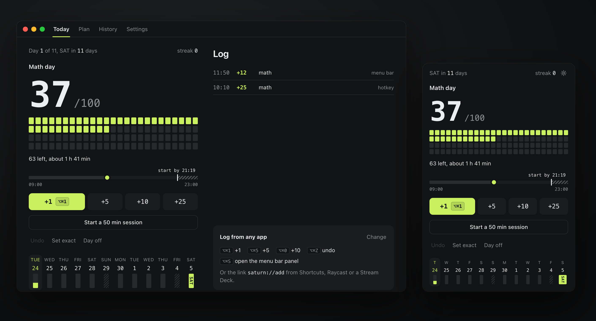
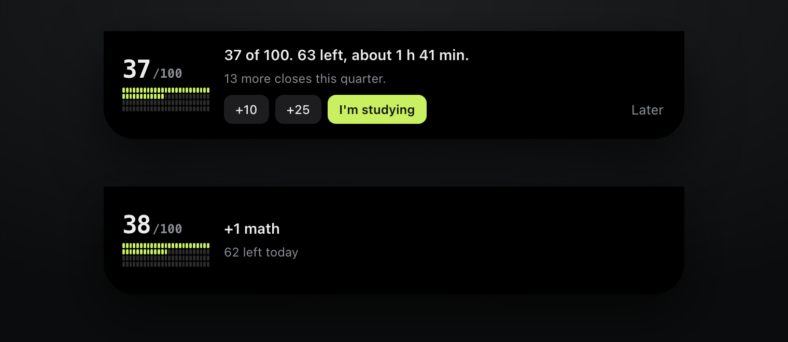
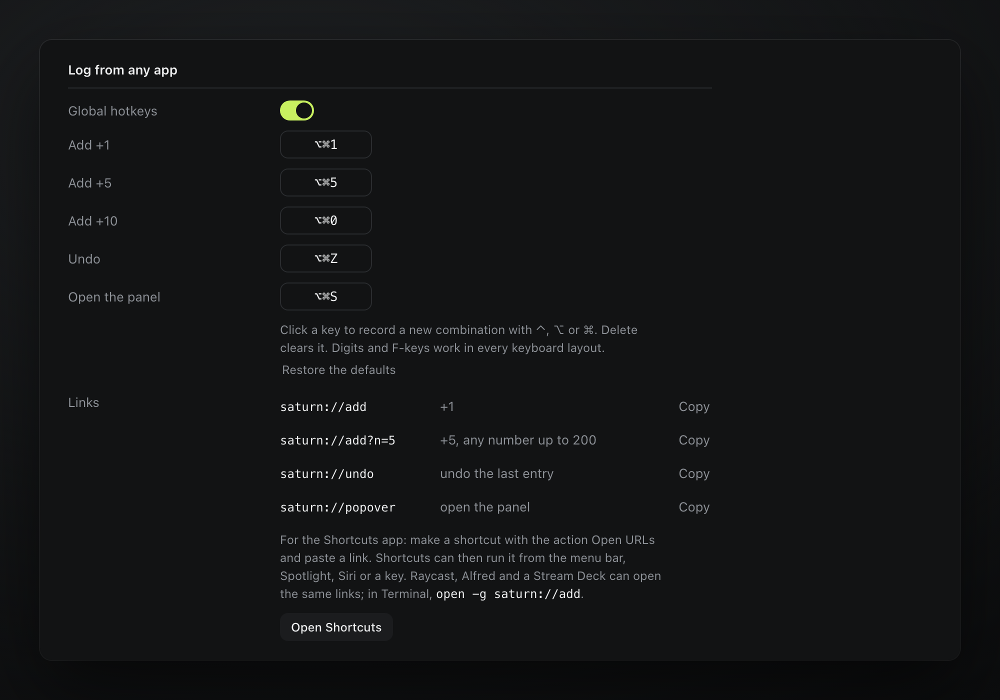
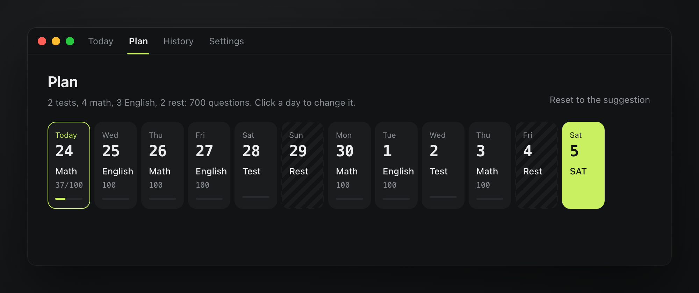

<p align="center">
  
</p>

<h1 align="center">SATurn</h1>

<p align="center">
  <b>The menu bar app that will not let today's SAT practice slip.</b><br>
  One count a day. A reminder every hour until it is closed. Zero questions shown, zero accounts, zero network.
</p>

<p align="center">
  <a href="https://github.com/Publicthrone547/SATurn/releases/latest"></a>
  
  
  
</p>

---

Two weeks before the SAT the problem is not knowing what to study. It is the hour you meant to start and didn't.

SATurn sits in the menu bar and holds you to a plan you wrote yourself. Every day is **100 math questions**, **100 English questions** or **one full practice test**. You solve them wherever you already do (Bluebook, a book, a site), and after each one you press **+1**. Until the day is done, SATurn comes back every hour with the exact number left and the latest time you can still start.

It is a reminder, not a study platform. It never shows a question and never checks your work. It only counts what you tell it.

## The day at a glance

The panel under the menu bar item answers three questions without reading a sentence.

- **How much is done?** A tally of 100 cells, one per question, four rows. Every row is a quarter of the day, so 100 is four small finishes, not one wall. Each +1 lights the next cell.
- **When do I have to start?** A line of your reminder hours. The dot is now. The hatched part is the work you have left, pushed as late as it can go, and the mark in front of it is the last moment to begin: `start by 21:19`. Every entry you log slides it later.
- **What about the rest of the plan?** A strip of every day to the exam, each a small bar that fills as you work. Rest days are hatched; the exam is the lime tag at the end.

The menu bar itself always shows the count, `37/100`, so you see it without clicking.

## Silent while you work, impossible to miss when you don't

| Situation | What SATurn does |
| --- | --- |
| You started a session (25, 50 or 90 min; 150 for a test) | Nothing. At the end it asks once: how many did you solve? |
| You logged something in the last 20 minutes | Skips the next reminder. You are clearly working. |
| You are away from the Mac for more than 5 minutes | Holds the reminder until you are back. |
| You ignore it | Escalates. Two ignored: the island under the notch stays until you answer, with a sound. Four ignored: the menu bar switches to `! 37/100`. |
| The latest start has passed | Stops pretending. `50 of 100 still fit before 23:00`, every 30 minutes, with an alarm. |
| Tomorrow is a rest day, or you are sick | Mark it. Reminders stop and the streak survives. |

Reminders arrive as notifications you can answer without opening anything: tap **+10**, **+25** or **I'm studying**, or type a number into the reply field. **Later** lets you promise a start time (15 min, 30 min, 1 hour) and SATurn holds you to it.

The day ends at 04:00, so a late night still counts for the day it belongs to.

<p align="center">
  
</p>

## +1 without leaving the question

Logging has to cost less than the question itself, or the count goes stale and the reminders start lying. So +1 works from anywhere.

**Hotkeys**, system-wide. Record your own in Settings → Log from any app.

| Keys | Action |
| --- | --- |
| <kbd>⌥</kbd><kbd>⌘</kbd><kbd>1</kbd> | +1 |
| <kbd>⌥</kbd><kbd>⌘</kbd><kbd>5</kbd> | +5 |
| <kbd>⌥</kbd><kbd>⌘</kbd><kbd>0</kbd> | +10 |
| <kbd>⌥</kbd><kbd>⌘</kbd><kbd>Z</kbd> | undo the last entry |
| <kbd>⌥</kbd><kbd>⌘</kbd><kbd>S</kbd> | open or close the panel |

**Links**, for anything that can open a URL:

| Link | Action |
| --- | --- |
| `saturn://add` | +1 |
| `saturn://add?n=5` | +5, any number from 1 to 200 |
| `saturn://undo` | undo the last entry |
| `saturn://popover` | open or close the panel |
| `saturn://open` | the main window |

Each entry from a hotkey or a link flashes the new count under the notch for a moment, so you know it landed without looking away.

<details>
<summary><b>Make a +1 button in the Shortcuts app</b></summary>

1. Open Shortcuts and create a new shortcut named `+1 SAT`.
2. Add the action **Open URLs** and type `saturn://add`.
3. In the shortcut's details, turn on **Pin in Menu Bar**, or add a keyboard shortcut.

Now it also runs from Spotlight and Siri. Raycast, Alfred and a Stream Deck can open the same link, and so can Terminal:

```sh
open -g saturn://add
open -g "saturn://add?n=25"
```

</details>

<p align="center">
  
</p>

## A plan you wrote

On first run SATurn suggests a plan counted back from the exam: practice tests spaced out, one on the same weekday as the real thing, rest before the day. Click any day to change it to math, English, a test, a test plus questions, rest or sick, and set its target.

<p align="center">
  
</p>

**Strict mode** (on by default) disables Quit while today is unfinished. You can still get out: Settings → Strict mode → Quit anyway, then type `I am done for today`. Logging out or shutting down is never blocked.

## Install

1. Download `SATurn-<version>-darwin-arm64.dmg` from [the latest release](https://github.com/Publicthrone547/SATurn/releases/latest) and drag SATurn to Applications.
2. The app is not notarised, so macOS refuses the first launch. Open System Settings → Privacy & Security and click **Open Anyway**.
3. Walk through the four setup steps: the exam date, the hours SATurn may remind you (09:00 to 23:00 by default), the plan, and notifications, launch at login and your target score.
4. In System Settings → Notifications → SATurn, choose the **Alerts** style so reminders stay on screen until you answer.

Requires macOS 14 or later on Apple silicon.

## Your data

Everything stays on your Mac. SATurn has no account, no analytics and no network code.

| What | Where |
| --- | --- |
| The plan, the counts, the settings | `~/Library/Application Support/SATurn/state.json` |
| A plain text log of what it did and why | `~/Library/Logs/SATurn/saturn.log` |

**Uninstall:** turn off Settings → Launch at login, quit SATurn, then delete `/Applications/SATurn.app` and `~/Library/Application Support/SATurn`. After the exam, SATurn offers a button that does the first two steps for you.

## Build from source

You need Go 1.27, Node 26 and the Wails CLI v3.0.0-beta.30 (`go install github.com/wailsapp/wails/v3/cmd/wails3@v3.0.0-beta.30`).

```sh
git clone https://github.com/Publicthrone547/SATurn.git && cd SATurn
make app        # bin/SATurn.app
make install    # replace /Applications/SATurn.app and start it
make test       # Go and frontend tests
make simulate   # print a simulated day of reminders
make release    # checks, then bin/release-<version>/ with the dmg and SHA256SUMS
```

To work on the interface without the app, run `npm run dev:mock` in `frontend/` and open `http://127.0.0.1:9246/#/popover`, `#/island` or `#/main`. A fake backend plays a math day at 37 of 100; flags such as `?red=1`, `?task=test`, `?done=1` or `?island=tally` show the other states.

The bundled binary reads a few development switches: `SATURN_DATA_DIR` (a separate data folder), `SATURN_DRY=1` (no notifications, sounds or login changes), `SATURN_NOW` and `SATURN_SPEED` (a fake, fast clock), `SATURN_TICK`, `SATURN_IDLE`, `SATURN_OPEN` and `SATURN_SCRIPT`.

<details>
<summary><b>How it is put together</b></summary>

| Part | What it is |
| --- | --- |
| `internal/core` | The whole product as pure Go with no clock and no I/O: days, the plan, the reminder engine (quiet rules, escalation, the latest start, promises), every reminder text, and the snapshot the interface draws. Tested against full simulated days. |
| `*.go` at the root | The shell: menu bar item and menu, notifications, the notch island, hotkeys and `saturn://` links, launch at login, sounds. The only place where the core meets the clock, the disk and the system. |
| `frontend/` | Vue 3 and Tailwind 4 in three webviews: the panel, the main window and the island. They hold no state; every button calls the shell and draws the snapshot it returns. |
| `tools/` | Generators for the app icon and the sounds, which are synthesised in Go rather than downloaded. |

</details>

## Name

SAT, plus "your turn", plus the planet with the ring. One day, one count; thirteen of them, then the exam.
